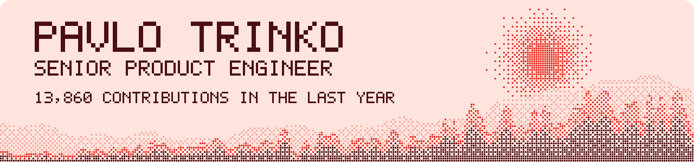

  

  
  
  
  

I build web, mobile and desktop apps, and the developer tools I need to ship
them. Coding agents write most of the code; I own the product decisions and the review.

## What I'm building

<table>
  <tr>
    <td width="64" align="center" valign="middle"></td>
    <td valign="middle"><strong>Storedeck</strong> Google Play and App Store Connect accounts, releases and reviews in one desktop app.</td>
    <td align="right" valign="middle"><a href="https://storedeck.app">storedeck.app</a></td>
  </tr>
  <tr>
    <td width="64" align="center" valign="middle"></td>
    <td valign="middle"><strong>gplay</strong> Publish to Google Play from CI or a coding agent. One binary, JSON output, semantic exit codes.</td>
    <td align="right" valign="middle"><a href="https://github.com/PollyGlot/google-play-cli">repo</a> · <a href="https://gplay.sh">docs</a> · <a href="https://github.com/PollyGlot/google-play-cli-skills">skills</a></td>
  </tr>
  <tr>
    <td width="64" align="center" valign="middle"></td>
    <td valign="middle"><strong>Verbum</strong> Multilingual reading, search and translation, offline-first.</td>
    <td align="right" valign="middle">private</td>
  </tr>
</table>

**Open source:** [T3 Code](https://github.com/pingdotgg/t3code/pulls?q=is%3Apr+author%3APollyGlot+is%3Amerged), merged PRs on the mobile and web clients
